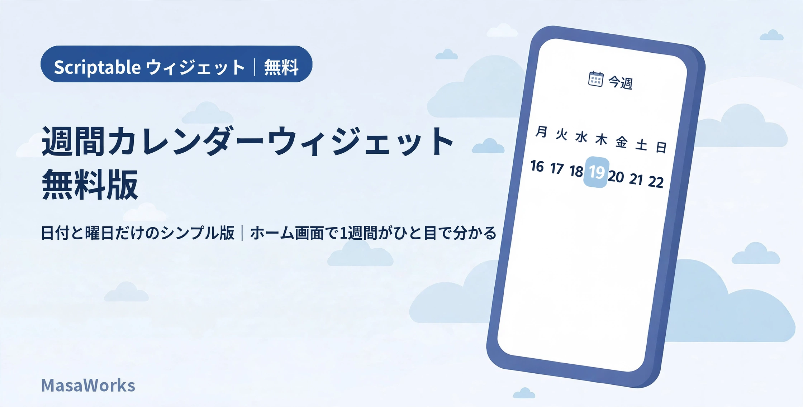

# 週間カレンダー ウィジェット（Scriptable・無料簡易版）

iPhoneのホーム画面に「月曜始まりの1週間」を横長で表示する、Scriptable用ウィジェットです。
日付と曜日だけに絞った無料の簡易版で、初期値のままコピペで使えます。

## 特徴

- 横長（ミディアム）サイズ／月曜始まりの1週間を横並び表示（日曜日は翌週を表示、過ぎた日は薄く表示）
- 今日の列をほんのりハイライト
- 背景は単色で、昼＝白／夜＝濃紺に自動切替（切替時刻は設定で変更可能）
- 列幅は固定値＋予算計算で全日均等（Scriptableの柔軟spacerは行の両端のみに置く設計）

## 導入手順

1. App Storeで無料アプリ **Scriptable** をインストール
2. Scriptableを開き、右上の「＋」で新規スクリプトを作成
3. `WeekCalendarLite.js` の中身をすべてコピーして貼り付け、名前を付けて保存
4. ホーム画面を長押し →「＋」→ Scriptable → ミディアムサイズを追加
5. 追加したウィジェットを長押し →「ウィジェットを編集」→ Script で手順3のスクリプトを選択

## カスタマイズ

書き換えるのはファイル冒頭「設定」セクションの数字だけです（半角数字）。

- `DAY_START_HOUR` / `DAY_END_HOUR`：昼／夜の配色が切り替わる時刻（初期値 6 / 18）

## 簡易版と完全版の違い

| | 簡易版（このリポジトリ・無料） | 完全版（BOOTH ¥800） |
|---|---|---|
| 日付・曜日表示 | ○ | ○ |
| iPhoneカレンダーの予定表示 | ― | ○ |
| 天気（Open-Meteo）表示 | ― | ○ |
| 祝日表示 | ― | ○ |

- 完全版: https://masaworks.booth.pm/items/9156826
- 簡易版のBOOTH配布ページ: https://masaworks.booth.pm/items/9158065
- くわしい解説（note）: https://note.com/masaworks_oo/n/nebc06d0c1daa

## ライセンス

個人利用は自由です。再販売はできません。

---

# Week Calendar Widget for Scriptable (Free Lite Edition)

A Scriptable widget that shows a Monday-first week on your iPhone home screen (medium size).
This free lite edition shows dates and weekdays only, and works out of the box — just copy and paste.

- Today's column is subtly highlighted
- Background switches automatically: white by day, dark navy by night (times are configurable)
- Full version with calendar events, weather and holidays: https://masaworks.booth.pm/items/9156826

By [MasaWorks](https://note.com/masaworks_oo) — practical AI and iPhone tooling notes, also on [Substack](https://masaworks.substack.com).
